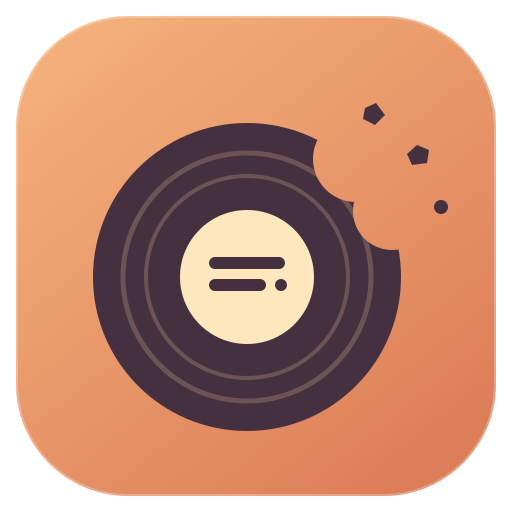
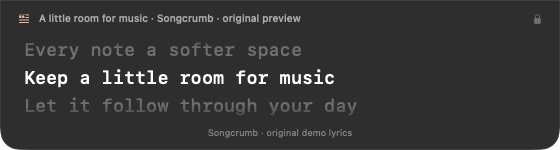
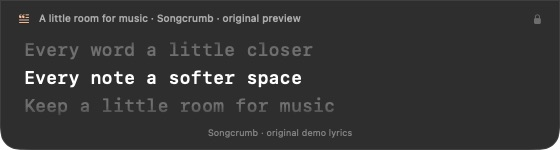
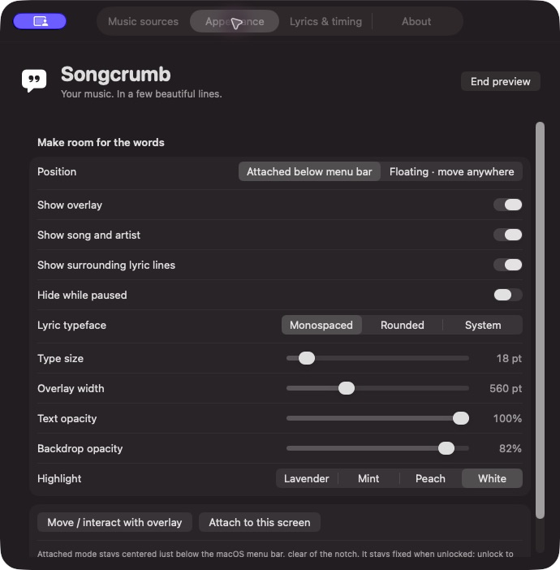
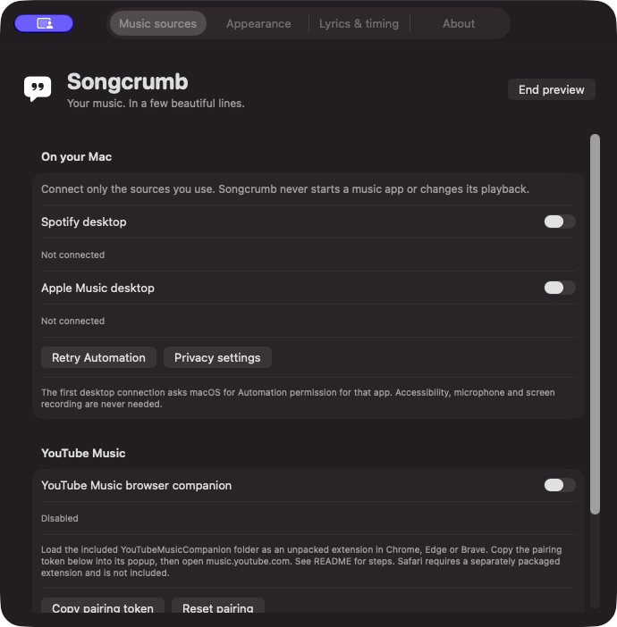

<p align="center"></p>
<h1 align="center">Songcrumb</h1>
<p align="center"><strong>Keep the words close.</strong><br>A little room for music on your Mac.</p>

Your music has something to say. Songcrumb keeps a few lines in view while you do your thing: a native macOS menu bar app that automatically finds lyrics and lets them follow the song.

Its compact panel sits flush beneath the menu bar, with monospaced type, a bright current line and quietly faded context. Let it stay there, or switch to a floating overlay. Lock it and your clicks pass straight through to the app underneath.

**macOS 14+ · Apple Silicon · SwiftUI + AppKit · No third-party Swift dependencies**

**[↓ Download for Mac · DMG](https://github.com/akshatdhabi/songcrumb/releases/download/v1.0.0/Songcrumb-1.0.0-arm64.dmg)** · [ZIP](https://github.com/akshatdhabi/songcrumb/releases/download/v1.0.0/Songcrumb-1.0.0-arm64.zip) · [Install guide](#download-and-install)

*Developer preview for Apple Silicon. Ad-hoc signed; not notarized by Apple.*

## See it in motion



*Captured from the native app with original Songcrumb preview lyrics. The loop demonstrates line highlighting and scrolling; it is not a live music-service recording.*

<details>
<summary>More native screenshots: overlay, appearance and music connections</summary>

<p></p>
<p></p>
<p></p>

*Real native screenshots. Music connections are off in the preview. No commercial lyrics or personal listening data are included.*

</details>

## What it does

- Reads Spotify and Apple Music desktop playback through public Apple Events. Sources are opt-in; it never launches a music player or changes playback.
- Connects to a YouTube Music tab through the included, paired Chrome / Edge / Brave companion. This integration is experimental and depends on the page’s player metadata.
- Finds the recording online through LRCLIB: exact lookup, then a bounded fallback search that checks artist, title, version and duration. No manual lyric files needed.
- Follows line timestamps when available. Plain text stays explicitly unsynced; unavailable lyrics get an honest status. It doesn’t invent timing or extract your player’s licensed lyrics.
- Offers typeface, size, highlight, transparency, width, context and timing controls. A nonactivating panel keeps keyboard focus with your work.
- Slows polling when idle or in Low Power Mode and pauses work during display sleep. M5 battery performance has not been benchmarked.

## Download and install

**[Download the Mac preview · DMG](https://github.com/akshatdhabi/songcrumb/releases/download/v1.0.0/Songcrumb-1.0.0-arm64.dmg)** · [ZIP alternative](https://github.com/akshatdhabi/songcrumb/releases/download/v1.0.0/Songcrumb-1.0.0-arm64.zip) · [All release files](https://github.com/akshatdhabi/songcrumb/releases/tag/v1.0.0)

**Apple Silicon · macOS 14+ · No Xcode needed for the compiled download**

1. Download and open the **DMG**.
2. Drag **Songcrumb → Applications**, then eject the disk image.
3. Open Songcrumb from Applications. Look for its quotation-mark icon in the menu bar.

The ZIP contains the same compiled app: expand it and drag Songcrumb.app to Applications. The [install guide](docs/INSTALL.txt) also covers first launch, optional YouTube Music pairing, uninstalling and SHA-256 checksums.

**Preview signing:** the app is ad-hoc signed and **not notarized by Apple**. macOS may block a downloaded copy. If you trust this project, use the app-specific **Open Anyway** option in **System Settings → Privacy & Security**, when offered after trying to open it; see [Apple’s guidance](https://support.apple.com/guide/mac-help/mh40616/mac). If that option is unavailable, build the source locally. No step disables Gatekeeper or removes quarantine.

### Prefer to build it yourself?

**Xcode:** open **Songcrumb.xcodeproj**, select **Songcrumb → My Mac**, and Run. For a stable Automation identity, configure your own Apple Development team.

**Command Line Tools:** [download the source](https://github.com/akshatdhabi/songcrumb/archive/refs/tags/v1.0.0.zip), expand it, open Terminal in that folder and run:

```sh
./Scripts/build.sh
open build/Songcrumb.app
```

The source build targets arm64 and uses local ad-hoc signing by default.

On first launch, use **Preview overlay** for original sample text. Then enable the music apps you use in Settings and allow their macOS Automation prompts. Online lookup is already configured with this project’s GitHub URL. **No personal email or account is needed.**

For YouTube Music, load **YouTubeMusicCompanion/** as an unpacked Chromium extension, enable the companion in Songcrumb, and pair using the token from Settings. See the [full setup guide](docs/SETUP.md) for steps and troubleshooting.

## A few practical limits

The compiled download is a developer preview. A normal Apple-verified installation experience still requires Developer ID signing and notarization. The app’s use of public APIs does not guarantee layering over every full-screen or system-owned surface.

LRCLIB is community supplied. A matching API response does not establish a copyright licence for every lyric, and coverage or timing may be wrong. Use content you have rights to display. A licensed HTTPS backend adapter is included for agreements that support this overlay; details are in [Setup](docs/SETUP.md). No commercial lyrics, cookies, private player APIs or provider keys are bundled.

Live Spotify / Music / YouTube Music playback, permission prompts and M5 energy use still need manual validation. [Verification](VERIFICATION.md) states exactly what passed and what remains untested.

## Explore the project

- [Project page](docs/index.html) — original Songcrumb artwork and an interactive desktop illustration; open locally or serve `docs/`.
- [Setup and architecture](docs/SETUP.md) — supported players, provider contract, permissions and primary API references.
- [Privacy](PRIVACY.md) and [security](SECURITY.md) — what leaves the Mac and how the local bridge is constrained.
- `Songcrumb/Core/` — playback, matching, LRC parsing and bridge validation.
- `Songcrumb/App/` — SwiftUI, the attached/floating panel and native adapters.
- `YouTubeMusicCompanion/` — inspectable browser bridge, with no build step.

Run `./Scripts/test.sh` for native core/provider checks, a real loopback integration test and browser-companion fixtures. Node.js is required for the companion checks. Full Xcode also supports `swift test` for the shared core suite. Regenerate project file lists with `python3 Scripts/generate_project.py` when adding native source files.

Made by **Akshat Dhabi** for the songs between everything else.

[MIT licensed](LICENSE). The licence covers this code and original artwork/demo text; it grants no rights to third-party song lyrics or player trademarks.
