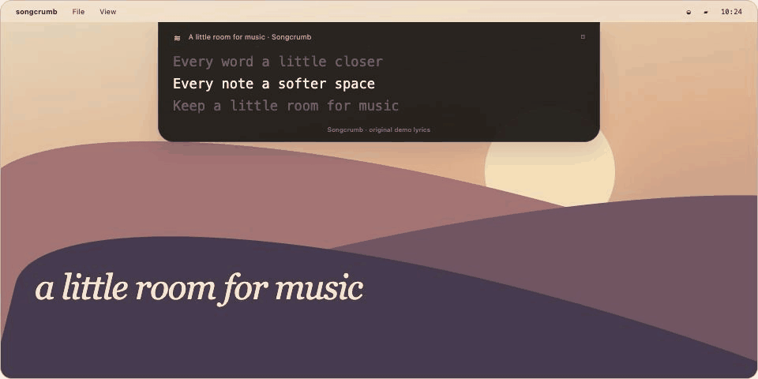

<p align="center">
  
</p>

<p align="center">
  A few lines from your music, right beneath the menu bar.<br>
  Native macOS. Automatic lyrics. A little room for your everyday soundtrack.
</p>

<p align="center">
  <a href="https://github.com/akshatdhabi/songcrumb/releases/download/v1.1.0/Songcrumb-1.1.0-arm64.dmg"><strong>Download for Mac ↓</strong></a>
  &nbsp; · &nbsp;
  <a href="https://github.com/akshatdhabi/songcrumb/releases/download/v1.1.0/Songcrumb-1.1.0-arm64.zip">ZIP</a>
  &nbsp; · &nbsp;
  <a href="docs/SETUP.md">Setup guide</a>
</p>

<p align="center"><sub>macOS 14+ · Apple Silicon, including M5 · v1.1 developer preview · MIT</sub></p>

<p align="center">
  
  <br><sub>From the interactive project-page preview. Illustrated desktop; original demo words.</sub>
</p>

## Your soundtrack, within sight

Songcrumb finds lyrics online and keeps a few lines in view while you work. The current line glows; the rest fades into the background.

- **Settle it in.** Attach beneath the menu bar or float anywhere. Choose its monitor, including in full screen. Lock it to let clicks pass through without taking focus.
- **Make it yours.** Adjust the typeface, size, highlight, transparency and width.
- **Follow the song.** Lyrics scroll to available timestamps. Plain lyrics remain clearly unsynced; temporary server failures retry quietly.

| Your music | Connection |
| :--- | :--- |
| Spotify | Desktop app · macOS Automation |
| Apple Music | Desktop app · macOS Automation |
| YouTube Music | Paired Chrome, Edge or Brave companion · experimental |

## Make room for music

1. **[Download the DMG](https://github.com/akshatdhabi/songcrumb/releases/download/v1.1.0/Songcrumb-1.1.0-arm64.dmg)** and drag Songcrumb into Applications. No Xcode needed. Prefer a ZIP? Expand it and move the app there instead.
2. **Open Songcrumb.** Find its quotation-mark icon in the menu bar. Try **Preview overlay** to see it in action.
3. **Connect your player** in Settings and allow its macOS Automation prompt. Lyrics lookup is already configured. No account or email needed.

**First launch:** this preview is ad-hoc signed and **not notarized by Apple**. macOS may require the app-specific **Open Anyway** option under **Privacy & Security**. See the [install guide](docs/INSTALL.txt) for the complete steps and checksums.

For YouTube Music, install and pair the included browser companion using the [setup guide](docs/SETUP.md).

<details>
<summary><strong>A closer look at the native app</strong></summary>

<br>
<p align="center"></p>

| Appearance | Music connections |
| :---: | :---: |
|  |  |

These are native app captures with original sample text. Music connections are off in the screenshots.

</details>

<details>
<summary><strong>Build it yourself</strong></summary>

Open **Songcrumb.xcodeproj** in Xcode, choose **Songcrumb → My Mac**, then Run. Configure your own development team for a stable Automation identity.

Or use Apple’s Command Line Tools from the project folder:

```sh
./Scripts/build.sh
open build/Songcrumb.app
```

SwiftUI + AppKit, arm64, with no third-party Swift dependencies. Run `./Scripts/test.sh` for the native and browser-companion checks; the companion checks also require Node.js. See [verification](VERIFICATION.md) for results and remaining manual checks.

</details>

## A small, open project

Lyrics come from community-supplied LRCLIB or a licensed provider you configure. Matching, coverage and timing vary; API availability does not grant rights to every lyric. Songcrumb does not extract lyrics from music players. Live player compatibility and M5 battery use still need manual validation. [Provider and permission details →](docs/SETUP.md)

[Privacy](PRIVACY.md) · [Security](SECURITY.md) · [Verification](VERIFICATION.md) · [Release notes](docs/RELEASE-NOTES.md) · [Local project page](docs/index.html)

Made by **Akshat Dhabi** for the songs between everything else.

<sub>[MIT licensed](LICENSE). Covers the code and original artwork/demo text; third-party lyrics retain their own rights.</sub>
